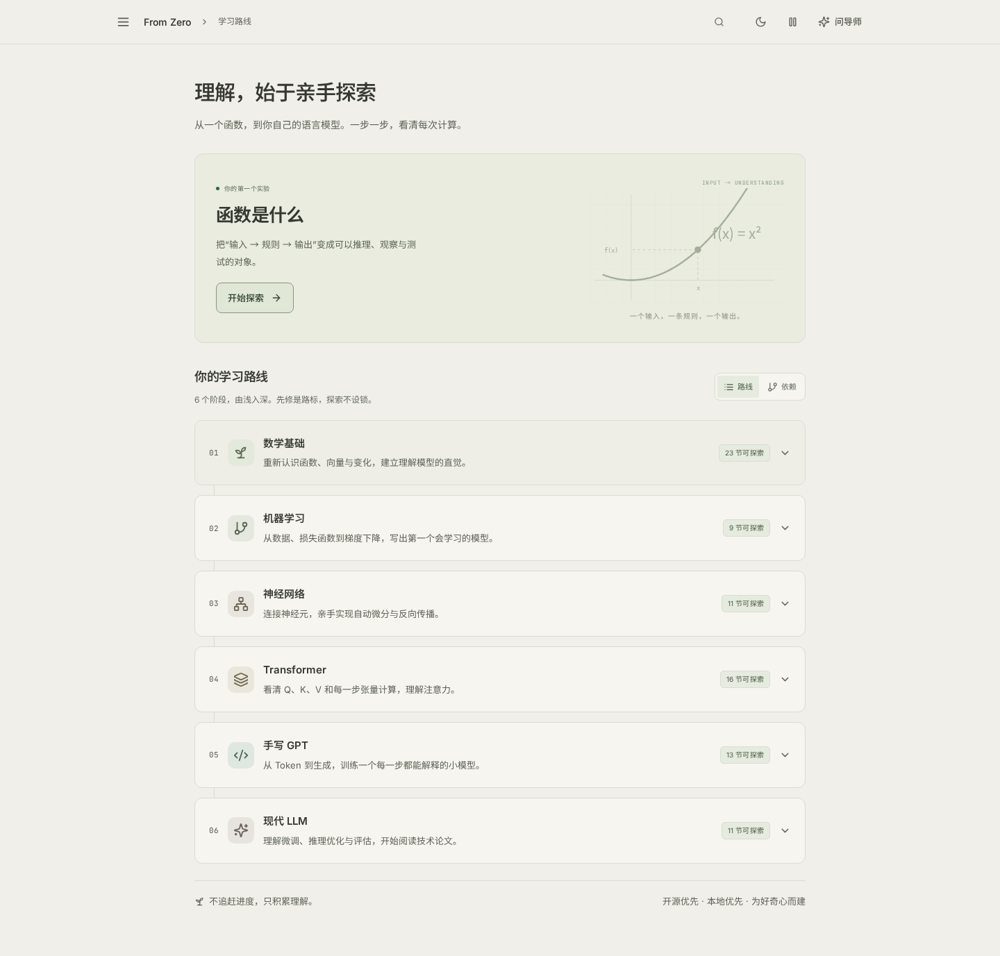
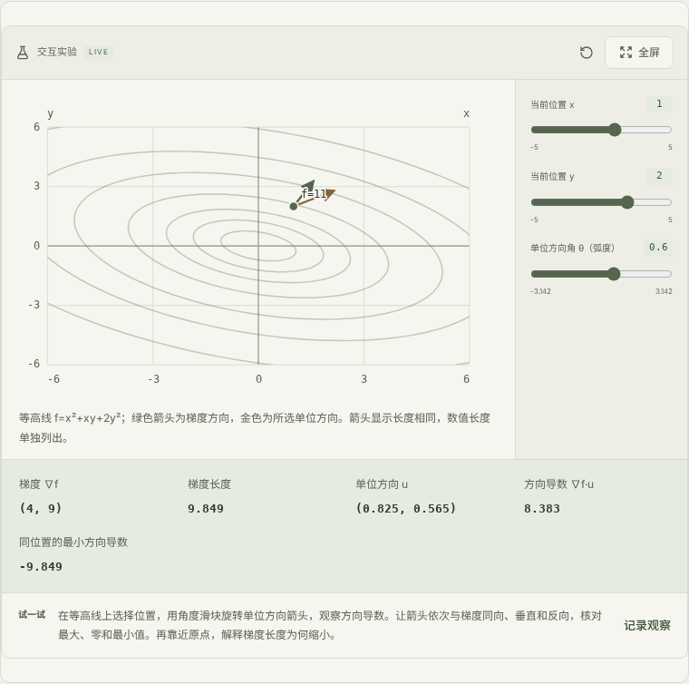
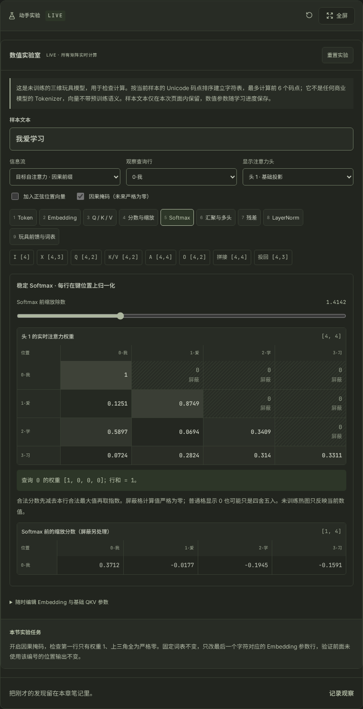
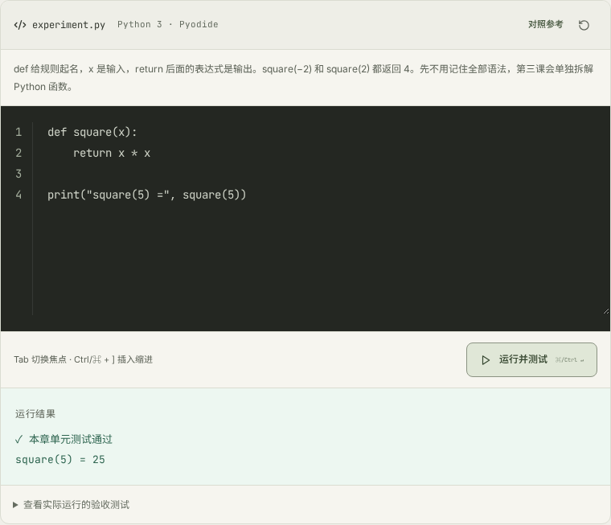

# From Zero to GPT

**从一个函数，到自己实现的语言模型。**

一个中文优先、本地优先的交互式 LLM 学习项目：用六阶段、83 章教材，把数学直觉、图形实验、Python 练习和三个独立工程连起来。适合有一些编程经验、希望从数学基础重新走到 Transformer 与 GPT 的自学者；无需先配置 AI 密钥，也不要求 GPU。

[快速开始](#快速开始) · [界面预览](#界面预览) · [学习路线](#学习路线) · [参与贡献](#参与贡献) · [许可证](#许可证)



## 你可以做什么

- **按自己的节奏学习**：每章从「读懂直觉 → 动手实验 → 自测理解」开始，数学推导、代码实现和深入研究按需展开。
- **让公式动起来**：调整参数观察梯度、回归损失、计算图、Q/K/V、注意力权重与因果 mask，图形响应真实计算。
- **在浏览器写 Python**：独立 Worker 中的 Pyodide 执行代码和章节断言，支持运行、停止、重置、参考实现与错误定位。
- **完成可带走的作品**：下载并独立运行线性回归、标量自动微分与 XOR 网络、微型 GPT 三个工程。
- **保存学习现场**：进度、笔记、代码、实验参数和导师对话保存在浏览器；支持导出、导入，以及记录问题与下一步后暂停。
- **按需使用 AI 导师**：接入 OpenAI 兼容接口，围绕当前章节提问；选中文字或实验图后可将引用带入草稿。

当前版本为 **0.3.8**。课程、实验和基础代码练习都可在不接入模型服务的情况下使用。

## 快速开始

### 环境要求

| 依赖 | 要求 | 用途 |
| --- | --- | --- |
| Node.js / npm | Node.js **22.18+**，推荐 24 LTS；安装时包含 npm | 本地网站、依赖安装与构建 |
| Python | **3.10+**，推荐 3.12 | 启动检查、教学工程打包与本地课程验证 |
| 浏览器 | 支持 WebAssembly、Web Worker 和 IndexedDB 的现代浏览器 | 图形实验、浏览器 Python 与学习记录 |
| PyTorch | 仅运行独立 tiny-GPT 工程时另行安装 | 本地 CPU 训练与生成；网站启动不需要 |

首次安装 npm 依赖需要网络。基础浏览器 Python 运行时随依赖复制到本地，不依赖外部 Python CDN；网站服务进程不执行学习者提交的 Python 代码。

### 启动学习网站

```bash
git clone https://github.com/Thweki/from-zero-to-gpt.git
cd from-zero-to-gpt
npm run launch
```

也可以[下载仓库 ZIP](https://github.com/Thweki/from-zero-to-gpt/archive/refs/heads/main.zip) 后解压。启动器会检查环境、按锁文件安装依赖、准备 Python 运行时和工程下载包，服务就绪后打开 **http://localhost:5173**。保留终端，按 **Ctrl+C** 停止。

| 平台 | 对应入口 |
| --- | --- |
| Linux | `sh start-linux.sh` |
| macOS | 双击 `start-macos.command`，或运行 `sh start-macos.command` |
| Windows | 双击 `start-windows.bat` |

无桌面环境或需要指定端口时：

```bash
npm run launch -- --check
npm run launch -- --no-open --port 5180
```

默认端口被占用时会明确报错。学习记录按浏览器地址保存，`localhost`、`127.0.0.1` 和不同端口使用不同的数据空间；恢复学习时请继续使用原地址。完整环境排查见 [启动指南](docs/LAUNCHER.md)。

### 先试一章

打开「函数是什么」，依次读懂直觉、调整实验参数、完成自测；再切换「代码实现」，修改代码并点击「运行并测试」。不必一次完成全部扩展，也没有签到、倒计时或学习时长要求。

## 界面预览

以下截图取自当前项目的本地运行界面，使用独立浏览器会话。Python 截图中的输出与验收结果来自实际执行。

### 数学直觉与图形实验

「梯度与方向」把当前位置、方向和梯度结果放在同一处，便于调整参数后比较变化。



### 看见因果注意力

深色主题下的因果 mask 实验：可检查注意力矩阵，未来位置的权重严格为零。



### 写代码，再用断言验证

浏览器内运行平方函数，显示实际输出 `square(5) = 25`，并通过本章的 Python 验收测试。



## 学习路线

| 阶段 | 章节 | 学习重点 | 可以完成的内容 |
| --- | ---: | --- | --- |
| 01 数学基础 | 23 | 函数、矩阵、概率、导数、梯度与优化 | 用图形和代码解释基础数学 |
| 02 机器学习 | 9 | 数据划分、损失、梯度更新与泛化 | 无框架线性回归与逻辑回归练习 |
| 03 神经网络 | 11 | 计算图、反向传播、优化器与 MLP | 标量自动微分引擎与 XOR 网络 |
| 04 NLP / Transformer | 16 | Token、Embedding、Q/K/V、注意力、mask 与归一化 | 逐张量检查 Transformer 数据流 |
| 05 手写 GPT | 13 | Tokenizer、Block、交叉熵、训练、保存与采样 | 本地可训练的微型 GPT |
| 06 现代 LLM | 11 | SFT / DPO、KV Cache、量化、LoRA 与评估 | 推理对照实验、资源估算与论文阅读 |

完整章节、先修关系和阶段验收见 [课程体系](docs/CURRICULUM.md) 与 [知识图谱](docs/KNOWLEDGE_GRAPH.md)。路线标明先修知识，学习者仍可自由跳转。

### 三个独立工程

| 工程 | 内容 | 运行依赖 |
| --- | --- | --- |
| [regression](projects/regression/README.md) | 训练、评估、保存与加载线性回归模型 | Python 标准库 |
| [micrograd](projects/micrograd/README.md) | 标量自动微分、数值梯度检查与带种子的 XOR MLP | Python 标准库；可选 PyTorch 对照 |
| [tiny-gpt](projects/tiny-gpt/README.md) | 显式因果多头注意力、LayerNorm、MLP、训练与自回归采样 | 本地 Python + CPU PyTorch |

三个工程都可从课程页面下载 ZIP，也可直接进入上述目录运行。tiny-GPT 使用原创 CC0 英文模板语料，默认约 6 万参数；它用于学习训练与推理流程，生成文本仍会有错误与重复。网页里的概率演示与这个可训练 Transformer 是不同模型；完整 PyTorch 训练在本地 Python 中进行。实测与边界见 [tiny-GPT 验证记录](projects/tiny-gpt/VALIDATION.md) 和 [KV Cache / LoRA / int8 实验](projects/tiny-gpt/EFFICIENCY.md)。

## AI 导师（可选）

若尚无 `.env`，复制根目录 [.env.example](.env.example) 为 `.env`；已有配置时直接编辑。填写自己的 `TUTOR_PROVIDER`、`TUTOR_BASE_URL`、`TUTOR_MODEL` 和 `TUTOR_API_KEY`，然后启动或重启服务。接口需兼容 OpenAI Chat Completions。未配置或服务不可用时，课程、实验和代码练习仍可使用。

密钥仅由服务端读取，不要提交 `.env`，也不要用 `VITE_*` 保存秘密。默认发送本章教材、问题和最近对话；代码、错误与笔记分别由默认关闭的分享选项控制。选区引用先进入可编辑草稿，确认后才发送。模型输出不会自动执行，回答仍需自行核对。

公网自托管时可配置独立 `TUTOR_ACCESS_TOKEN`；配置字段、同源与请求边界见 [架构说明](docs/ARCHITECTURE.md#配置与部署)，引用文字与图片的行为见 [选区提问](docs/SELECTION_TUTOR.md)。

## 学习记录与备份

数据保存在当前浏览器的 IndexedDB，不会自动跨浏览器、设备或域名同步。可以在设置页导出学习 JSON；导入会替换当前记录，操作前请先备份。清除站点数据也可能清除进度、笔记与对话。

「保存思路，立即结束」可留下当前问题、下一步、代码与运行结果，下次从首页继续。阅读、自测、代码验收与自评掌握分别记录，避免把完成动作等同于理解。

## 开发与验证

本项目使用 React、TypeScript、Vite、KaTeX 和 Pyodide；可选导师代理同时提供 Node 与 Cloudflare Worker 入口。

```bash
npm ci
npm run dev
```

开发服务默认使用端口 5173。修改后运行：

```bash
npm run check
npm test
npm run validate:course
npm run build
```

浏览器回归需要 Playwright Chromium：

```bash
npx playwright install chromium
npm run test:e2e
```

已有系统 Chromium 时，可将 `PLAYWRIGHT_CHROMIUM_EXECUTABLE_PATH` 设置为本机浏览器可执行文件的路径。

独立 Python 工程按各自 README 运行测试；tiny-GPT 需先安装 CPU PyTorch。GitHub Actions 配置见 [ci.yml](.github/workflows/ci.yml)，实际结果查看 [Actions](https://github.com/Thweki/from-zero-to-gpt/actions/workflows/ci.yml)。验证范围与历史记录见 [测试报告](docs/TEST_REPORT.md)。

### 目录导航

```text
src/data/           课程正文、章节 ID 与先修知识图
src/components/     阅读、实验、代码、笔记与导师界面
server/             导师请求校验、上游代理与 Worker 入口
projects/           三个可独立运行的 Python 教学工程
public/             浏览器运行资源、字体许可与生成的下载包
scripts/            启动、课程验证、构建与打包工具
docs/               课程规划、架构、使用说明与验证记录
```

架构与内容扩展先读 [ARCHITECTURE](docs/ARCHITECTURE.md) 和 [DEVELOPMENT_PLAN](docs/DEVELOPMENT_PLAN.md)；新增课程需要同步章节 ID、先修关系、实验和验收。

### 自行部署

```bash
npm ci
npm run build
npm start
```

Node 服务默认监听 `127.0.0.1:8787`，可通过 `HOST`、`PORT` 配置。对外部署应使用 HTTPS 反向代理，并设置 `TUTOR_PUBLIC_ORIGIN`。纯静态托管可以发布 `dist/`，但不包含导师 API；浏览器 Python、字体和工程 ZIP 需完整保留。

Cloudflare 配置见 [wrangler.json](wrangler.json)，构建与交付方式见 [CI / 交付说明](docs/GITHUB_CICD.md)。如使用 Sites，请配置自己的项目身份，勿复用仓库中的既有站点绑定。当前 CI 交付构建产物，不自动发布生产站点。

## 参与贡献

欢迎修正教材、补充更清楚的解释与实验、改进可访问性，或报告可复现的问题。

1. 在 [Issues](https://github.com/Thweki/from-zero-to-gpt/issues) 说明问题、预期行为与复现步骤；涉及界面时可附不含私人数据的截图。
2. 从当前 `main` 创建自己的分支，保持一次改动围绕一个明确问题；课程引用应指向原始论文或官方资料，并保留第三方版权声明。
3. 运行上面的类型检查、单元测试、课程验收和构建；涉及界面交互时补充相关浏览器回归。
4. 在 Pull Request 中说明改动原因、验证结果与尚存限制。请勿提交密钥、个人学习备份、依赖目录、模型权重或生成的构建产物。

## 许可证

Copyright (c) 2026 From Zero to GPT contributors。

应用源码、原创中文教材与三个教学工程采用 **[GPL-2.0-only](LICENSE)（GNU GPL 第 2 版，仅此版本）**。历史提交中的 MIT 声明保留，已按 MIT 授予的权利不被撤回。

第三方依赖、字体和引用内容仍适用各自许可，详见 [THIRD_PARTY_NOTICES](THIRD_PARTY_NOTICES.md)。原创 tiny-GPT 语料继续采用 [CC0-1.0](projects/tiny-gpt/data/LICENSE.txt)。

## README 编排参考

本说明借鉴以下项目的文档组织方式，未复制其正文、图片或代码：

- [LLMs-from-scratch](https://github.com/rasbt/LLMs-from-scratch#readme)：清楚列出先决条件，并用章节表连接学习内容与源码。
- [nanoGPT](https://github.com/karpathy/nanoGPT#readme)：提供可直接运行的快速开始，并说明示例输出的能力边界。
- [llm-course](https://github.com/mlabonne/llm-course#readme)：以学习路线组织资料，让读者先找到适合自己的入口。
