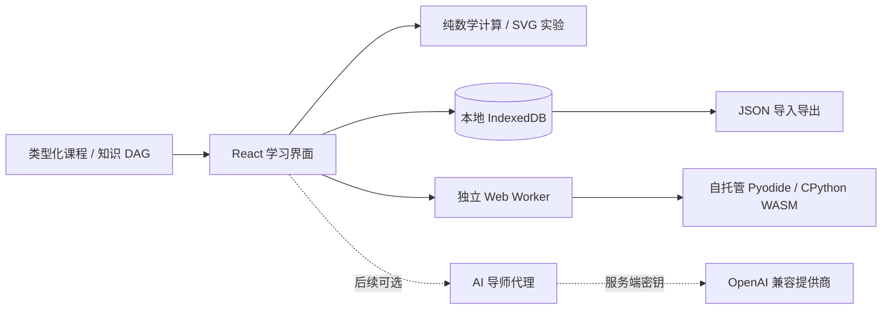

# 技术架构

## 选择与边界

MVP 采用 React 19 + TypeScript + Vite 6，输出可自托管的静态资源。IndexedDB 通过 `idb` 保存学习数据；KaTeX 显示公式；原生 SVG 绘制并重新计算数学实验；Lucide 提供图标。基础 CSS 保持小依赖面，当前课程不需要引入图形编辑器或大型代码编辑器。

课程、状态、实验数学和界面分离。首批内容以类型化 TypeScript Lesson 对象编写，避免 MVP 引入额外 MDX 编译约定；未来可在保持 Lesson ID 与元数据契约的前提下增加 MDX。完整 DAG 是 JSON 数据，规划节点没有空教材页面。

本文描述 MVP 的架构约定和扩展设计；实际文件、功能及验证以进度和测试报告为准。

## 内容契约

`src/types.ts` 中的 `Lesson` 是教材结构契约。`id` 是长期稳定的标识，章节可增加但不要直接重命名。每章包含先修、四种解释层、实验类型、初始代码、参考代码、断言测试、练习、自测、误区和参考资料。

`src/data/knowledge-graph.json` 提供 `{ version, nodes }`；节点包含 `{ id, title, stage, prerequisites, available }`。先修边指向依赖目标。`available` 仅标记已交付教材，与学习者是否掌握完全独立。

## 本地数据

`LearningState` 使用版本号 1，保存主题、最近章节、各章状态、笔记、代码、模式、实验参数、复习标记、运行结果和可选 checkpoint。Checkpoint 保存当前章、问题、下一步、代码快照、运行结果和时间。

写入 IndexedDB 应反馈真实保存状态，加载完成前不以默认数据覆盖旧数据。存储失败时显示明确错误，允许导出当前内存状态。JSON 导入先校验版本、字段类型、合法 Lesson ID 与合理长度，再替换状态；错误数据不能清空原记录。导出包括学习数据，不含任何 API 密钥。

本地优先不等于永久备份：浏览器清理、隐私模式或存储配额可能移除数据，因此必须保留导出入口。MVP 不做云同步、身份体系或跨设备账号迁移。

## Python 运行

基础实验运行在专用 Web Worker 内的 Pyodide CPython WASM。`scripts/copy-python.mjs` 从锁定 npm 依赖复制运行时到 `public/python/`，构建时进入静态资源；不依赖外部 CDN 或付费接口。首次运行需加载 WASM 与标准库，当前实现每次运行创建新 Worker，执行完毕后释放；浏览器 HTTP 缓存可复用运行时文件。

用户代码不得在网站 Node 服务进程中执行。运行错误和断言结果来自 Python 执行，不能用固定字符串伪造成功。超时或停止操作应 `terminate()` Worker，并在下一次执行时重建；避免无限循环阻塞主界面。每次执行应使用隔离的 Python globals，防止前次变量意外影响本次结果。

Web Worker 是响应性和计算环境边界，不是面向恶意多租户代码的通用安全沙箱。MVP 仅执行学习者在自己浏览器主动输入的代码；不要自动执行导入的草稿。Pyodide 不提供本地 GPU/PyTorch 训练环境，不假装可以完成其不支持的实验。

后续 PyTorch 训练使用独立本地工程：固定依赖、明确 CPU/GPU 能力、可复现种子和文件输出。若引入远程执行，应使用独立容器或微虚拟机、非特权用户、无宿主挂载、网络默认关闭、资源与时长限制及任务队列；不得把任意 Python 执行接入网页服务本身。

## 数学实验

数值由同一组参数驱动 SVG 和公式反馈。函数实验显示输入与输出的对应关系；线性函数显示斜率、截距和点值；二维向量显示坐标、长度和方向；点积显示逐分量乘积、总和及夹角关系。零向量夹角未定义，不能除以零或显示误导角度。

图表提供坐标和数值替代说明，原生 range/input 支持键盘。动画服务于参数变化，尊重减少动态效果偏好。

## AI 导师扩展（未实施）

新增可选独立后端或本地代理，前端仅发送章节 ID、允许共享的局部代码、问题和难度。后端从环境变量或专用密钥存储获取提供商密钥，通过 OpenAI 兼容接口请求模型。

- 不将服务端密钥写入 `VITE_*`、静态包、浏览器 localStorage/IndexedDB 或导出数据。
- 服务端限制可配置上游地址，防止 SSRF；实施请求大小、速率、超时与取消机制。
- 明示当前哪些笔记或代码将发送，默认仅提供必要上下文；核心课程离线于 AI 也可用。
- 默认策略为提示、追问、先修复习和局部代码建议。主动请求完整解答时再切换，界面不把模型输出当数学真值。
- 测试提供商错误、超时、敏感日志过滤和无密钥路径，不伪造真实 AI 回复。

## 验证与部署

Vitest 检查纯计算、DAG、导入数据与保存逻辑；CPython 验证参考实现及断言；Playwright 检查导航、实验、主题、持久化、恢复、导入导出和移动布局。具体执行结果和限制见 TEST_REPORT。

`npm run build` 生成 `dist/`；可部署到普通静态托管或本地 HTTP 服务，无核心业务服务器。保留 MIT 源码、lockfile、课程和全部文档，便于后续 Agent 从当前进度继续。
