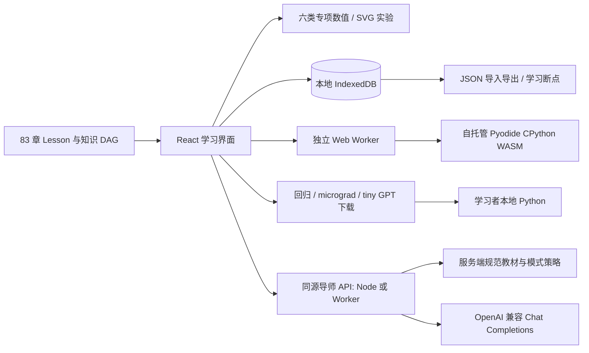

# 技术架构

## 交付边界

系统使用 React 19、TypeScript、Vite、IndexedDB、原生 SVG、KaTeX 和自托管 Pyodide。六阶段共 83 个稳定 Lesson ID：数学 23、机器学习 9、神经网络 11、Transformer 16、GPT 13、现代 LLM 11。教材、交互计算、浏览器 Python 与本地训练工程是相互对应的不同层次，不能用其中一层的结果冒充另一层已经执行。

教材、笔记、自测、可视化、浏览器 Python 和工程下载可以部署为静态站点。AI 导师另外需要 Node 服务或带静态资源绑定的 Worker；单独上传 `dist/` 不会获得模型 API，也不影响核心学习流程。实际验收结果、部署地址和剩余限制见 `PROGRESS.md` 与 `TEST_REPORT.md`。

## 教材与实验分层

`src/types.ts` 的 `Lesson` 是内容契约。`src/data/foundations.ts` 保留最初五章；`stage1.ts` 至 `stage6.ts` 补齐各阶段，`lessons.ts` 聚合并提供按 ID 查询。每章有问题动机、目标、直觉、数学、代码、深入解释、误区、实验任务、TODO 起始程序、参考实现、真实 Python 断言、四选一自测与来源。公式使用 `String.raw`，验收时严格经过 KaTeX 解析。

`src/data/lesson-ids.ts` 定义稳定 ID 联合类型，`knowledge-graph.json` 保存标题、阶段与先修。先修关系是 DAG；依赖不等于强制锁课，也不等于学习进度。增加或修订教材时，必须同步图、聚合器、实验路由与验收，保留既有 ID，避免旧笔记失联。

`LessonLab.tsx` 按 `lesson.lab` 分派并懒加载六个专项实验，基础函数、直线、向量、点积继续使用 `MathLab.tsx`。专项计算包括：

| 组件 | 主要计算与呈现 |
| --- | --- |
| `AdvancedMathLab` | 矩阵、概率、导数、梯度与优化中的可核算数值和图形 |
| `MachineLearningLab` | 带种子的合成数据、训练/验证划分、回归或分类、梯度更新与指标 |
| `NeuralLab` | 神经元、两隐藏单元前向、批次表、计算图、解析/差分梯度、优化器状态、L2 与 Dropout 缩放 |
| `TransformerLab` | Token/向量到 QKV、注意力权重、因果 mask、多头与层间数据流 |
| `GPTLab` | 小型语言建模、训练/采样与逐步概率反馈，明确与本地张量模型的差别 |
| `ModernLLMLab` | 缓存、精度与内存、低秩更新及评估等章节的缩小数值模型 |

滑块、表格、公式和 SVG 由同一组当前参数驱动，按钮执行真实数值步骤。数值核心应可独立测试，包含维数、边界与守恒性质，例如概率行和、因果遮罩和有限差分。图形需提供文本或数值替代，原生控件支持键盘，布局支持窄屏。缩小维数、固定掩码或估算资源的地方必须在界面标明，不能把示意网络称作完整现代 LLM。

## 本地数据与恢复

`LearningState` 版本 1 使用 `idb` 保存主题、最近章节、各章模式与状态、笔记、代码草稿、自测、实验参数、复习标记、运行结果、导师对话和提问草稿。Checkpoint 保存问题、下一步、代码快照与运行结果。导师对话按章节保留，当前每章最多 80 条；导入时验证角色、时间和长度。

界面等待加载完成再保存，反馈实际保存状态；存储失败时保留内存数据并允许导出。JSON 导入先验证版本、合法 ID、字段类型、文字长度和实验数值，成功后才替换状态。导入的代码与笔记只是数据，不自动执行。新增实验参数必须同步 `storage.ts` 的允许字段和范围，不然刷新时会拒绝原本可用的状态。

导出含学习者的代码、笔记和导师对话，应作为个人备份保管。模型 API 密钥只存在服务端，不在这些状态、静态包或导出里。导师访问码仅在当前组件内存中使用，不写入 IndexedDB。浏览器清理、隐私模式和配额仍可能移除本地记录；本系统不提供账号云同步。

## Python 执行与项目产物

浏览器代码在每次新建的专用 Web Worker 中执行真实 Pyodide CPython。`scripts/copy-python.mjs` 从锁定 npm 依赖复制运行时至 `public/python/`，随静态站点部署，无需运行时外部 CDN。每次执行使用新的 Python globals，按先起始代码、再章节断言的顺序运行，显示真实输出、异常与测试结果。

停止或 30 秒超时会终止 Worker；完成后释放，下次重新创建，HTTP 缓存可复用运行文件。输出上限为 30,000 字符。Worker 保护主界面响应性并分离运行环境，不是面向恶意代码的通用安全沙箱。Pyodide 可接触部分浏览器能力；不要自动运行陌生导入代码，也不要把这一实现改成网页 Node 进程内执行任意 Python。

`projects/` 提供可独立运行的完整学习产物：

| 目录 | 环境 | 实际功能 |
| --- | --- | --- |
| `regression/` | Python 标准库 | 确定性数据划分、梯度训练、JSON 保存/加载、预测与独立测试指标 |
| `micrograd/` | Python 标准库 | 标量 `Value` 运算、逆拓扑反传、共享节点累加、数值梯度检查、带种子 2→8→1 XOR MLP 与 CLI |
| `micrograd/torch_compare.py` | 本地安装 PyTorch | 同一标量公式的真实 autograd 对照与独立初始化的 XOR 训练 |
| `tiny-gpt/` | 本地安装 PyTorch | 字符 tokenizer、显式 decoder-only Transformer、因果注意力、训练/验证、检查点恢复、温度/top-k/top-p 采样 |

`scripts/package-projects.mjs` 将源码、README、依赖说明、测试和适用的数据许可打包至 `public/downloads/regression.zip`、`micrograd.zip`、`tiny-gpt.zip`，构建后由静态服务器提供。打包排除虚拟环境、字节码与模型检查点。浏览器练习不导入 torch；完整张量训练必须按下载工程 README 在本地运行。XOR 训练拟合四个点与 tiny GPT 的模板语料结果都不代表真实任务的泛化能力。

## AI 导师代理

`TutorPanel.tsx` 提供主栏与紧凑侧栏两种入口，共享当前章节与本地对话。前端调用同源 `GET /api/tutor/status` 和 `POST /api/tutor/chat`；提供商凭证及上游地址由服务端环境配置，浏览器不能在请求里指定模型或 URL。

`server/tutor.ts` 验证请求并从自身导入的课程查找章节、问题、目标、公式、直觉、数学、练习、误区、先修与来源。普通模式附带提示，只有请求明确选择 `solution` 时才在服务端上下文加入参考实现与验收测试。客户端能选择提示、概念解释、先修复习或完整解答，以及解释难度。

代码与最近运行结果、笔记分别受两个默认关闭的分享复选框控制，服务端再次检查 `shareCode`、`shareNote`，不会仅因字段存在就转发。服务端接收代码最多 16,000 字符、运行结果 8,000 字符、笔记 4,000 字符；当前客户端分别截取前 8,000、3,000、2,000 字符，并按整体字节预算裁减最早对话。对话历史最多 12 条，每条最多 8,000 字符。问题最多 4,000 字符；整体请求仍受 64,000 字节上限约束，所以长历史与分享内容可能需要缩短。发出的这些内容会由配置的外部模型服务处理，须由学习者决定是否分享。

导师回复用 `react-markdown`、`remark-math`、`rehype-katex` 呈现 Markdown、代码块与公式，不启用原始 HTML 解析，并禁用模型或导入消息中的图片，避免未经点击的第三方请求。回答只作为待核查解释，不自动执行生成代码。默认的提示策略与完整解答限制是系统提示及资料最小化策略，不是可证明的语义隔离；模型仍可能出错、受输入影响或在提示模式给出过多内容。

## 请求边界与安全约定

- 提供商地址只能由服务端配置。默认要求 HTTPS，拒绝 URL 用户信息、查询参数、片段与重定向。`TUTOR_ALLOW_LOCAL_HTTP=1` 仅为显式使用 localhost、127.0.0.1 或 ::1 的 HTTP 模型服务开放例外；不是任意 HTTP 开关。管理员仍需审核自己配置的 HTTPS 目标，不能声称实现了所有私网地址的 SSRF 拦截。
- POST 检查同源 `Origin` 和跨站 fetch 标记，无跨域开放配置。该检查不是登录认证：脚本客户端可以没有 Origin。公开自托管可设置 `TUTOR_ACCESS_TOKEN`，前端以独立 Bearer 访问码提交；API 密钥永远只发往上游。
- 代理使用 60 秒超时和 AbortController，响应取消会传到上游。它限制请求读取量、上游响应 2 MB、显示回答 24,000 字符，非流式请求模型最多 2,400 tokens。错误回复描述凭证、限流、网络或超时，不回传上游原始错误正文和 API 密钥。
- 当前速率计数是单个进程或 Worker isolate 内存中的尽力限制：每个 actor 每小时 60 次、并发最多 2。Worker actor 取可信边缘提供的 `CF-Connecting-IP`；缺少时共享 `local` 桶。进程重启、多个实例或可伪造的代理头都会削弱此限制，它不是计费防护或分布式配额系统。
- 对公网部署，应在可信网关配置访问认证与持久化限流，清理外部伪造的客户端地址头，并按服务能力设置额度。独立访问码不是多用户账号系统；需要用户身份、撤销、审计与额度时，应接入相应基础设施。

服务端不记录学习者全文、不执行学习者代码，也不把模型输出作为新的系统指令。反向代理和提供商可能有各自日志政策，部署者应单独确认。不要把服务端密钥放入 `VITE_*`、源码、前端配置、示例命令输出或学习数据。

## 配置与部署

| 服务端环境变量 | 用途 |
| --- | --- |
| `TUTOR_API_KEY` | 模型提供商凭证；未设置时导师返回未配置状态，核心课程仍可用 |
| `TUTOR_BASE_URL` | OpenAI 兼容接口根路径或完整 `/chat/completions` 地址 |
| `TUTOR_MODEL` | 上游模型 ID |
| `TUTOR_PROVIDER` | 界面显示的提供商名称 |
| `TUTOR_ACCESS_TOKEN` | 可选独立访问码，限制对自部署代理的访问 |
| `TUTOR_ALLOW_LOCAL_HTTP` | 默认关闭；仅本地回环 HTTP 模型服务需要设置为 `1` |

默认连接信息为 OpenCode Go、`https://opencode.ai/inference/go/openai/v1` 与 `deepseek-v4.1-flash`，提供商或订阅可用性由实际服务决定。配置是否有效以状态接口与真实调用结果为准，示例文件不含有效凭证。

本地开发复制 `.env.example` 为 `.env` 后，`npm run dev` 的 Vite 中间件代理导师请求。构建运行 `npm run build`，输出静态 `dist/`、Node 处理器 `dist-server/tutor.mjs`、Worker `dist-server/worker.js`；构建需要 `python3` 打包项目。`npm start` 用 Node 22.18+ 读取可选 `.env`，默认只监听 `127.0.0.1:8787`，可用 `HOST`、`PORT` 调整。生产入口应使用 HTTPS 反向代理，并保证转发给处理器的 origin 与浏览器同源。

Worker 部署以 `dist-server/worker.js` 为入口，绑定名为 `ASSETS` 的 `dist/` 静态资源；`/api/tutor/*` 必须先经过 Worker，其他路径由资源绑定处理。平台密钥存储设置 `TUTOR_API_KEY` 和可选访问码，普通变量设置模型及地址。发布时确认 WASM、`/python.worker.js`、字体、下载 ZIP 与 API 都在同一站点可达。只有 `dist/` 的普通静态托管不包含导师后端；`vite preview` 也不是生产 AI 代理。

普通 Cloudflare 部署使用根目录 `wrangler.json`。Sites 的归档布局另由 `scripts/package-site.mjs` 生成：`dist/server/index.js` 是打包后的 Worker，`dist/client/` 是完整静态输出，另附 `.openai/hosting.json`。`npm run package:site` 先构建再打包；归档不追踪且不包含环境变量。已在线验证该布局的资源绑定与导师 API，不可直接把 `dist-server/worker.js` 路径当作 Sites 支持的入口。

## 验证与扩展

`npm run check` 检查类型，`npm test` 检查教材门槛、DAG、公式、计算性质、本地存储和导师协议；`npm run validate:course` 在 CPython 中批量执行仓库自有参考程序与章节断言。项目目录各自有真实 Python 测试；tiny GPT 和 torch 对照需要独立安装 PyTorch。Playwright 负责导航、输入、图形变化、代码执行、恢复、数据导入导出、导师流程与移动布局。测试报告要区分模拟提供商的确定性测试、真实外部调用与实际本地训练。

扩展一章时先固定 ID、先修、数学与形状，再添加可运行练习及独立校验。扩展实验需同步参数持久化与无障碍路径。扩展导师提供商只改服务端变量，先用无密钥、错误、取消与限额测试核对兼容性。若将来需要远程代码执行，应建立独立受限容器或微虚拟机与任务队列，不得把它塞进现有导师代理或网页进程。

## 0.3.0 本地 GPT 整合

`projects/tiny-gpt/model.py` 保留训练前向与完整窗口推理，增加显式逐层缓存接口；缓存形状为 `[B,H,S,d]`，使用偏移位置和偏移因果 mask。生成器在绝对位置窗口移动时重建全部缓存，底层拒绝越界。`benchmark.py` 对共同 Token 轨迹逐步比较 logits，计数投影位置、缓存张量字节并测量 CPU 中位时间。

`efficient.py` 实现 LoRALinear、合并、逐输出通道 Int8Linear 与存储报告。仅 A/B 可训练，基座冻结并逐张量检查；适配器仅存低秩张量与元数据，绑定精确基座文件 SHA-256。int8 以 buffers 真正保存，前向临时反量化到浮点；没有整数 GEMM。格式1训练检查点保持兼容；格式2浮点／int8推理文件不含旧优化器，不能作为训练恢复输入。加载使用 weights_only，输出不能覆盖输入。

`tiny_gpt.py` 统一 train/evaluate/generate/inspect/benchmark/lora-train/merge-lora/quantize；支持先浮点LoRA再合并、量化、缓存生成，不声称QLoRA。`ProjectDownload.tsx` 给第五／六阶段同一工程源码下载，三章提供可执行命令与边界。ZIP 由打包脚本生成；PyTorch 始终在本机运行，不进入网站服务端。
