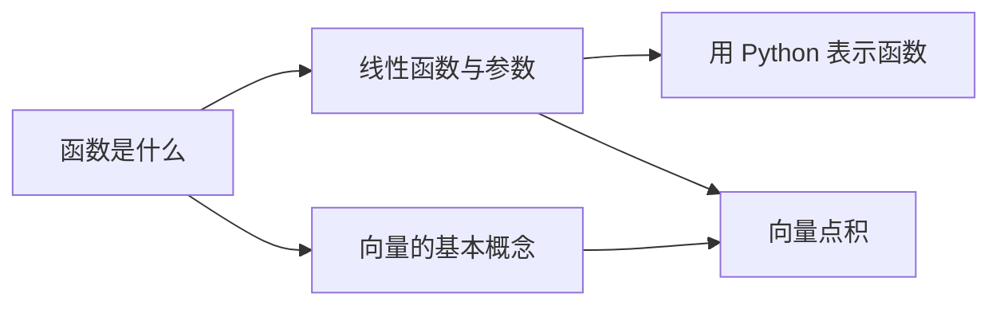
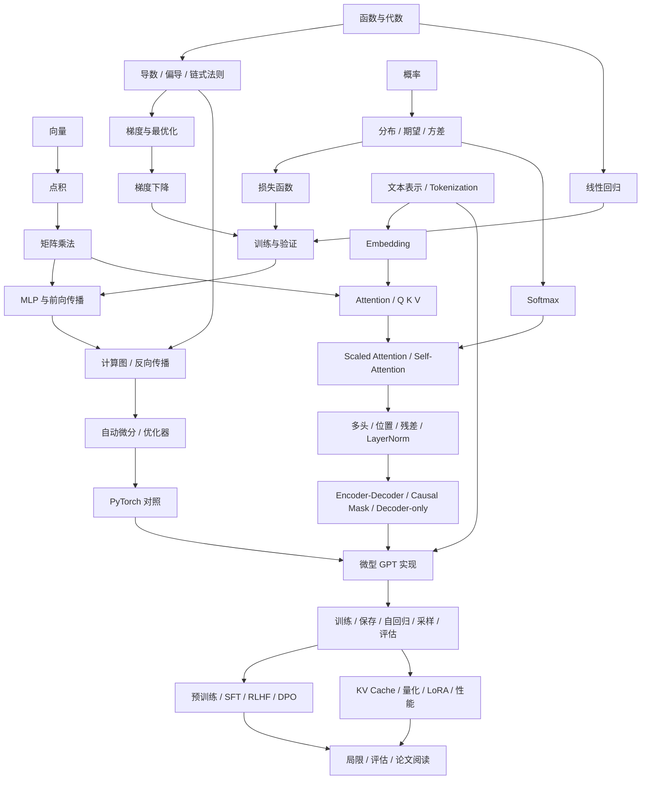

> 2026-10-23 更新：83 个节点均已交付首版，available 全为 true；状态与进度以当前源码及 PROGRESS 为准。

# 知识依赖图

机器可读的完整 DAG 位于 [src/data/knowledge-graph.json](../src/data/knowledge-graph.json)。每个节点包含稳定 `id`、中文 `title`、1–6 的 `stage`、先修 `prerequisites` 和教材可用性 `available`。`available: false` 表示规划；不得为这些节点生成空教材页面。依赖表示建议先修，不强制锁课。状态另存于学习者本地数据，不写入课程源文件。

## 第一组课程

## 主要通路

以上是便于阅读的概览，完整节点与跨阶段先修请查 JSON。课程新增必须保持唯一 ID、所有依赖存在、无环；状态迁移依赖稳定 ID，避免重命名破坏本地记录。若确实改名，需同时提供数据迁移。

## 维护验收

- 所有节点 ID 唯一，依赖目标必须存在；拓扑遍历必须覆盖全部节点。
- 0.2.0 可用集合严格等于图中的全部83个ID，并与 Lesson 聚合器一致。
- 可用节点须有真实 Lesson 内容、实验、自测、引用及可运行参考实现。
- 各阶段交付通过后才将对应 `available` 改为 true；不把计划等同于已完成。
- 搜索可以显示规划知识点，但进入动作只能到已发布教材或明确的路线信息。
