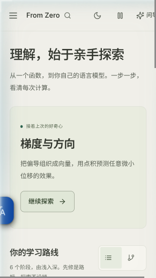
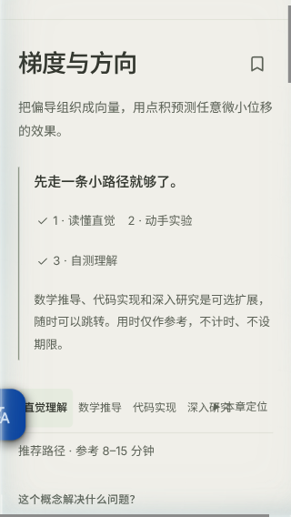
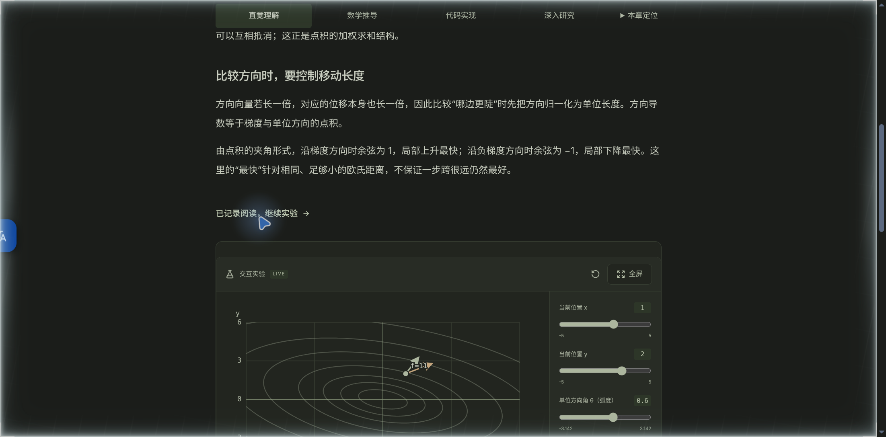
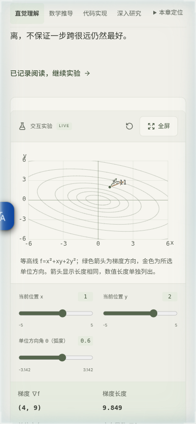
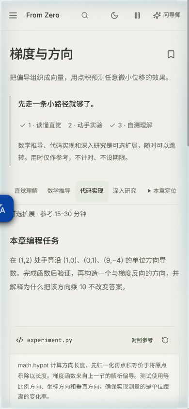
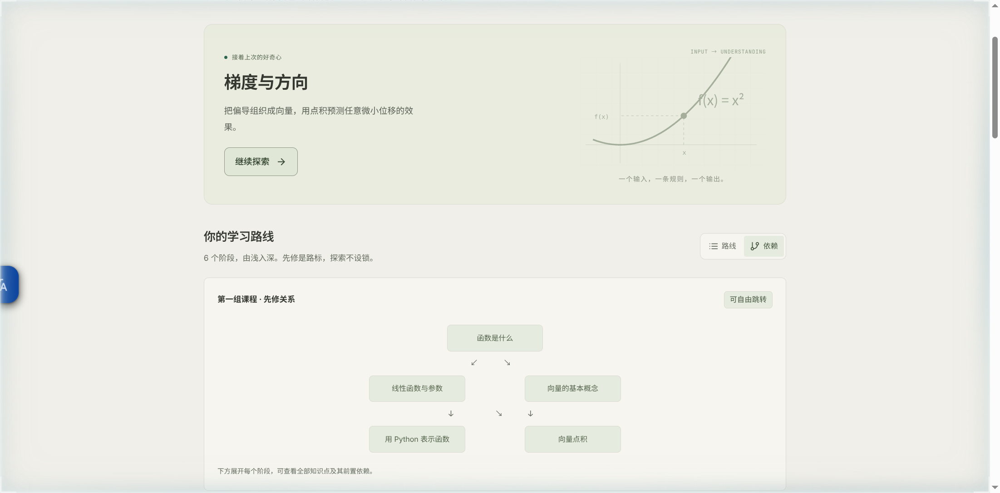

# From Zero to GPT：UI 实测与修复报告

> 用途：交给 GPT 或其他开发者直接实施修复。
>
> 测试日期：2026-10-27
>
> 测试地址：`http://localhost:8787/`
>
> 测试方式：Kimi WebBridge 控制真实浏览器，非仅静态代码审查。

## 1. 执行任务

请按本报告修复 UI 问题，并补充对应回归测试。优先处理 UI-01 至 UI-06；UI-07 是独立的体验优化，可在缺陷修复完成后实施。

### 修复约束

- 保持现有视觉风格、课程内容、学习流程和数据结构，不做无关重构。
- 优先修改现有 React 组件和 CSS，不为图表或响应式问题引入新依赖。
- 不只隐藏截图中的单个症状：检查同组组件、CSS 级联和其他课程实验是否受影响。
- 保留现有键盘操作、减少动态效果偏好和本地学习数据行为。
- 修复后必须运行项目现有检查和新增回归测试，不能用截图代替功能验证。

## 2. 实测范围与已正常工作的流程

覆盖环境：

- 桌面视口：约 `1510 × 745`。
- 移动视口：`390 × 844`、`360 × 800`、`320 × 568`。
- 浅色和深色外观。

已实际走通：

- 首页、侧边导航、路线/依赖视图切换。
- 搜索“梯度”并进入“梯度与方向”。
- 阅读记录、跳转实验、保存实验观察笔记。
- 自测选择、提交和正确反馈。
- Python 默认代码运行及验收断言失败反馈。
- 移动端学习助手抽屉。
- 搜索弹窗自动聚焦和 Esc 关闭。

这些现有行为不得因 UI 修复而回归。

## 3. 问题总览

| ID | 优先级 | 问题 | 主要位置 |
|---|---|---|---|
| UI-01 | P1 | 320px 下首页和课程页横向溢出，顶部操作被裁切 | `src/focus.css`、`src/learning-flow.css`、`src/App.tsx` |
| UI-02 | P2 | “去做实验”等章节跳转后的视口定位不佳 | `src/components/LessonReader.tsx`、`src/focus.css` |
| UI-03 | P2 | 移动端实验滑块触控高度约 28px | `src/components/labs/AdvancedMathLab.tsx`、实验控件 CSS |
| UI-04 | P2 | 手机代码编辑没有可用的缩进入口 | `src/components/CodeLab.tsx` |
| UI-05 | P3 | 小屏坐标图最后一个刻度与轴名碰撞 | `src/components/labs/AdvancedMathLab.tsx` |
| UI-06 | P3 | 搜索关闭后焦点丢失；隐藏文件输入形成不可见 Tab 停靠点 | `src/App.tsx` |
| UI-07 | P3 / 增强 | 依赖视图突然展开长列表，图形化信息有限 | `src/App.tsx`、`src/styles.css` |

---

## UI-01：320px 窄屏横向溢出和工具栏挤压

**优先级：P1，首先修复。**

### 复现

1. 打开 `http://localhost:8787/`。
2. 将视口设为 `320 × 568`，启用移动设备模拟。
3. 观察首页顶部。
4. 进入“梯度与方向”，观察四个模式页签与“本章定位”。
5. 在控制台读取 `innerWidth` 和 `document.documentElement.scrollWidth`。

### 实际结果

- 在 320px 设备视口下，实测布局视口和文档宽度均约为 **343px**。
- 首页顶部“问导师”被右侧裁切。
- 课程页“深入研究”和“本章定位”几乎连在一起。
- `360px`、`390px` 下未复现，说明需要覆盖窄屏边界，而不是重做所有移动布局。

### 截图

首页顶部裁切：



课程页工具栏挤压：



### 源码线索

- 顶部结构：`src/App.tsx:88`。
- 课程工具栏：`src/components/LessonReader.tsx:62-73`。
- `src/focus.css:74-93` 先前在移动端隐藏导师文字并缩小按钮。
- 但 `src/focus.css:106-108` 的后置规则又重新显示文字，并设置 `min-width:72px`，覆盖前面的纯图标规则。
- `src/learning-flow.css:54-62` 又将多个顶部控件固定为至少 44px。多组最小宽度叠加后超过 320px。
- `src/focus.css:84-87` 的模式页签使用 `white-space:nowrap`，也没有为极窄屏提供换行或滚动策略。

### 修复方向

- 合并/整理相互覆盖的移动端规则，明确最终级联结果，避免继续追加更高特异性补丁。
- 320px 下优先保留“问导师”的可访问名称，但可只显示图标；不能简单删除功能。
- 为 `.breadcrumb`、`.topbar-actions` 及其子项设置合理的收缩规则，保留必要点击区域。
- 课程工具栏可选择以下一种一致策略：
  - 窄屏下换成两行；或
  - 页签区域独立横向滚动，并提供可感知的滚动边界。
- 不应让整个文档横向滚动。

### 验收标准

- 在 `320`、`360`、`390`、`760px` 宽度下，首页和四种课程模式均满足：
  - `document.documentElement.scrollWidth <= (window.visualViewport?.width ?? innerWidth)`；
  - 所有顶部操作均完整可见且可点击；
  - 四个页签文字及“本章定位”不重叠；
  - 页签的左右方向键、Home、End 操作仍正常。
- 761px 及桌面宽度不出现新的布局回归。

---

## UI-02：章节跳转没有将目标工作区完整带到有效视口

**优先级：P2。**

### 复现

1. 桌面打开 `#/lesson/gradients`，保持“直觉理解”。
2. 点击“我已读完，去做实验”。
3. 等待平滑滚动结束，观察实验标题、图表和控件的位置。
4. 在移动端通过“2 · 动手实验”或“本章定位 → 跳到交互实验”重复检查。

### 实际结果

- 桌面端跳转后，实验区域仍从视口中部或偏下位置开始。
- 图表和控件需要再次手动滚动才能完整查看，削弱了“去做实验”按钮的直接导航意义。
- 移动端也需要继续滚动才能看到完整实验控制区。

### 截图



### 源码线索

- 跳转逻辑：`src/components/LessonReader.tsx:38-48`。
- 目标节点：`src/components/LessonReader.tsx:79-80`。
- 已有滚动偏移：`src/focus.css:40` 已设置 `scroll-margin-top:80px`，因此不要盲目再叠加一个固定偏移。
- 需要检查平滑滚动、目标容器高度、吸顶工具栏实际高度及异步图表布局是否共同影响最终位置。

### 修复方向

- 让章节导航以“目标标题出现在吸顶工具栏下方”为一致规则。
- 继续支持 `prefers-reduced-motion`。
- 保留目标节点获得焦点的行为，避免只改视觉位置而破坏键盘导航。
- 若异步图表尺寸变化会拉偏位置，应在布局稳定后校正，而不是用长时间固定延迟掩盖问题。

### 验收标准

- 点击“去做实验”和“跳到交互实验”后，`#lesson-experiment` 获得焦点，其实验标题位于吸顶工具栏下方且不被遮挡。
- 常见桌面高度下，至少实验标题和主要图表能立即进入有效视口，不需要用户先修正滚动位置。
- “跳到本章正文”“跳到 Python 代码”“跳到自测练习”也采用一致定位规则。
- 开启减少动态效果时跳转仍准确。

---

## UI-03：移动端实验滑块触控区域不足

**优先级：P2。**

### 复现

1. 以 `390 × 844` 打开 `#/lesson/gradients`。
2. 进入交互实验。
3. 测量“当前位置 x”“当前位置 y”“单位方向角 θ”对应的 `input[type=range]` 高度。

### 实际结果

- 实测滑块输入高度约 **28px**。
- 页面顶部移动控件已采用 44px 触控区，但实验滑块没有保持一致。
- 轨道本身不需要变粗，问题是可触摸区域不足。

### 截图



### 源码线索

- 通用高级数学实验滑块：`src/components/labs/AdvancedMathLab.tsx:148`。
- 梯度实验使用该控件：`src/components/labs/AdvancedMathLab.tsx:253-266`。
- 其他实验也有独立 range 实现；修复时检查 `MathLab.tsx`、`MachineLearningLab.tsx`、`NeuralLab.tsx`、`TransformerLab.tsx`、`GPTLab.tsx` 和 `ModernLLMLab.tsx`，避免只修一节课。

### 修复方向

- 在移动端或 `pointer:coarse` 环境中，将 range 的实际命中区域提高到至少 44px。
- 可通过输入高度、内边距或包装元素扩大命中区，保持当前轨道视觉粗细。
- 不破坏标签、当前值和最小/最大值的布局。

### 验收标准

- 320px 和 390px 下所有实验滑块可见、不溢出，命中高度至少 44px。
- 拖动和键盘方向键仍能改变数值，输出同步更新。
- 桌面视觉样式不发生不必要变化。

---

## UI-04：移动端代码编辑器只有键盘缩进提示

**优先级：P2。**

### 复现

1. 手机视口打开任意课程，切换到“代码实现”。
2. 查看运行按钮附近的操作提示。
3. 尝试在不使用物理键盘的情况下缩进代码。

### 实际结果

- 界面仍提示 `Tab 切换焦点 · Ctrl/⌘ + ] 插入缩进`。
- 触屏用户没有缩进入口；现有缩进逻辑只绑定在 `Ctrl/⌘ + ]`。
- 这是功能可达性问题，不只是文案问题。

### 截图



### 源码线索

- 编辑器和快捷键：`src/components/CodeLab.tsx:26`。
- 当前仅在 `onKeyDown` 中处理 `Ctrl/⌘ + ]` 和 `Ctrl/⌘ + Enter`。
- 移动样式只隐藏了部分 `kbd`，没有提供替代缩进操作。

### 修复方向

- 把缩进逻辑抽成编辑器与按钮都能调用的操作。
- 在触屏/移动布局提供“缩进”按钮；如实现减少缩进，也应遵循同样的选区行为。
- 保留桌面快捷键和 `Tab 切换焦点` 的无障碍设计，不要将 Tab 强行改成插入空格。
- 根据输入环境显示合适提示，避免手机只显示物理键盘说明。
- 不引入完整编辑器框架来解决这个小问题。

### 验收标准

- 移动视口存在可点击的缩进控件，点击后在当前位置/选中行正确插入四个空格，光标或选区位置合理。
- `Ctrl/⌘ + ]` 和 `Ctrl/⌘ + Enter` 原行为不回归。
- 运行、停止、重置、对照参考仍可用，页面无横向溢出。

---

## UI-05：坐标图最后一个刻度和 x 轴名碰撞

**优先级：P3，但修复范围明确。**

### 复现

1. 以 390px 打开“梯度与方向”的实验图。
2. 查看横轴最右侧。

### 实际结果

- 最后一个刻度 `6` 与轴名 `x` 显示为近似 `6x`。
- 函数值标注也较靠近箭头；本次必须修复的是刻度/轴名的确定性碰撞。

### 源码线索

- `src/components/labs/AdvancedMathLab.tsx:105`：最右刻度位于 `x=446`。
- `src/components/labs/AdvancedMathLab.tsx:118`：最右刻度以 `textAnchor="middle"` 绘制在 `y=282`。
- `src/components/labs/AdvancedMathLab.tsx:121`：轴名 `x` 位于 `x=453, y=280`，两者仅相隔约 7 个 viewBox 单位。
- 该 `Cartesian` 被多个高级数学实验复用，应在共享组件修复，而不是只改梯度课文字。

### 修复方向

- 调整轴名的位置、对齐方式或预留右侧空间，使任意最后一个刻度都不会与轴名重叠。
- 检查不同 `xmin/xmax` 和多位小数刻度，避免只让“6”这一例碰巧通过。
- 保持 SVG 的 `viewBox`、可访问名称和图形裁剪逻辑正常。

### 验收标准

- 320px、390px 和桌面下，梯度图及其他 `Cartesian` 图的轴名与末端刻度不重叠。
- 图表没有因此产生页面横向溢出。
- 图像的 `role="img"`、`aria-label` 和 `<title>` 保留。

---

## UI-06：搜索焦点恢复和不可见文件输入

**优先级：P3，无障碍修复。**

### 6A：关闭搜索后焦点丢失

#### 实测

- 打开搜索后，焦点会进入“搜索词”输入框，这是正确行为。
- 通过文档级 Esc 关闭搜索后，`document.activeElement` 不再回到原搜索输入框。
- 键盘用户会失去原来的操作位置。

#### 源码线索

- 搜索输入引用：`src/App.tsx:40`。
- 全局 Esc：`src/App.tsx:54` 只关闭状态，没有恢复搜索焦点。
- 关闭按钮和背景：`src/App.tsx:108` 也只调用 `setSearching(false)`。

#### 修复与验收

- 用统一的关闭搜索方法处理 Esc、关闭按钮和背景关闭，并在关闭后恢复到 `.search-box input`。
- 选择搜索结果并导航时不要强制把焦点拉回已不属于当前任务的搜索框。
- 验收：分别通过 Esc、关闭按钮、背景关闭，`searchRef.current` 均重新获得焦点；搜索跳转课程仍正常。

### 6B：隐藏文件输入仍可 Tab 聚焦

#### 实测

- 页面末尾的文件输入约为 `1 × 1px`，`visibility:visible`、`tabIndex=0`，没有 `aria-hidden`。
- 它可能产生不可见的键盘 Tab 停靠点。

#### 源码线索

- 文件输入：`src/App.tsx:107`。
- 隐藏样式：`src/styles.css:2` 的 `.visually-hidden`。
- 可见导入按钮：`src/App.tsx:101`，已经通过 `importRef.current?.click()` 触发文件选择。

#### 修复与验收

- 对该纯程序触发的文件输入设置 `tabIndex={-1}` 和 `aria-hidden="true"`，保留可见“导入学习数据”按钮的可访问名称。
- 验收：Tab 顺序中不再出现不可见文件输入；点击可见导入按钮仍能选择并导入合法 JSON，错误文件提示不回归。

---

## UI-07：依赖视图的长列表和图形化体验优化

**优先级：P3 / 独立增强，不要让它阻塞 UI-01 至 UI-06。**

### 实测

- 桌面路线视图初始文档高度约 1897px。
- 切换“依赖”后文档高度约 3440px。
- 首组只显示 5 个节点的字符箭头图，下方数学基础阶段却直接展开全部 23 节文字依赖。
- 用户从简洁路线切到依赖视图后，需要突然面对更长的页面。

### 截图



### 源码线索

- 视图状态：`src/App.tsx:115-116`。
- 字符箭头图：`src/App.tsx:122`。
- 过滤逻辑：`src/App.tsx:123` 中 `dependency` 会绕过 `showAllFoundations` 和前五节限制。
- 字符箭头样式：`src/styles.css:6` 的 `.dependency-flow`。

### 建议方向

- 切换路线/依赖视图时保留用户的阶段展开和“全部课程”状态，不要由 `dependency` 隐式强制展开全部节点。
- 长依赖列表默认收起，由用户显式展开。
- 如调整图形，优先用现有 SVG/CSS 实现清晰连线；无需引入图形库。
- 保留文字先修信息，确保图形不是唯一的信息通道。

### 验收标准

- 路线 → 依赖 → 路线往返不会擅自改变用户原先的展开状态。
- 未主动展开时不会一次性展示全部 23 节。
- 所有先修关系仍能通过文字获取，节点按钮仍可进入对应课程。

---

## 4. 回归测试要求

项目已有 Playwright 测试，请在现有测试风格上补充，不另建测试框架。

### 建议修改的测试文件

- `tests/mobile.spec.ts`
  - 增加 320px 场景，不要只依赖项目默认移动视口。
  - 覆盖首页、四种课程模式、顶部控件可见性和 `scrollWidth`。
- `tests/usability-touch.spec.ts`
  - 保留现有 44px 顶部控件断言。
  - 增加实验 range 命中高度和移动缩进按钮测试。
  - 该文件明确是 Chromium 触控模拟，不要声称验证了真实 iOS/Android 软键盘。
- `tests/lesson-modes.spec.ts`
  - 扩展章节跳转断言：除焦点外，还检查目标相对吸顶工具栏的位置。
  - 保留左右方向键、Home、End 和模式状态测试。
- 可在合适的现有测试文件中补充搜索 Esc/按钮/背景关闭后的焦点恢复，以及隐藏文件输入不进入 Tab 顺序。

### 建议关键断言

```ts
expect(await page.evaluate(() =>
  document.documentElement.scrollWidth <= (window.visualViewport?.width ?? innerWidth)
)).toBeTruthy();
```

这里使用 `visualViewport.width` 是必要的：本次 320px 移动模拟中，`innerWidth` 和 `scrollWidth` 会一起被内容撑到约 343px，只比较这两者可能错误地通过测试。还应断言关键控件边界的 `right <= visualViewport.width`，覆盖截图中的实际裁切。

```ts
const box = await page.getByRole('slider', { name: '当前位置 x' }).boundingBox();
expect(box!.height).toBeGreaterThanOrEqual(44);
```

不要只断言元素存在；必须覆盖实际布局、焦点或交互结果。

## 5. 完成定义

只有全部满足以下条件才可报告完成：

- [x] UI-01 至 UI-06 已修复并通过对应回归测试。
- [x] 320、360、390px 和桌面视口没有页面级横向溢出。
- [x] 深浅色下均检查过受影响组件。
- [x] 搜索、章节导航、滑块、代码运行和导入功能没有回归。
- [x] `npm test` 通过。
- [x] `npm run test:e2e` 通过。
- [x] `npm run check` 通过。
- [x] `npm run build` 通过。
- [x] 最终说明列出修改文件、测试结果，以及任何未能验证的真实设备限制。

## 6. 测试数据说明

本次 WebBridge 实测在浏览器本地写入了一条以“UI 实测”开头的实验观察，并将“梯度与方向”记录为已阅读、已验证。修复和测试时不要清空用户现有 IndexedDB 学习数据；自动化测试应使用独立浏览器上下文。

## 7. 实施记录

已按 UI-01 至 UI-07 修改，保持课程内容、存储结构和现有视觉风格，没有增加依赖。

| 文件 | 修改内容 |
|---|---|
| `src/App.tsx` | 搜索统一关闭并恢复焦点，阻止背景按下事件再次移走焦点；文件输入退出 Tab 顺序；依赖视图保留阶段和全部课程展开状态，并使用 SVG 连线。 |
| `src/components/LessonReader.tsx` | 测量实际吸顶工具栏高度；等待懒加载实验和字体布局就绪再定位；保留焦点及减少动态效果支持，手动切换模式取消待执行的跳转。 |
| `src/components/CodeLab.tsx` | 按钮与快捷键共享缩进操作；选中多行时逐行缩进并保留选区方向，移动端提供按钮和对应提示。 |
| `src/components/labs/AdvancedMathLab.tsx` | 共享坐标图的轴名与刻度分开定位，端点刻度向图内对齐，同时消除窄屏 y 轴名与最高刻度的重叠。 |
| `src/focus.css` | 统一顶部移动布局和 44px 控件；320px 导师按钮显示图标；课程工具栏分两行；跳转偏移使用实测工具栏高度。 |
| `src/learning-flow.css` | 删除重复的顶部移动控件规则，避免后置级联覆盖。 |
| `src/usability.css` | 所有移动或粗指针实验 range 至少 44px，覆盖懒加载样式；添加触屏缩进按钮和提示样式。 |
| `src/styles.css` | 依赖示意图使用可伸缩 SVG 连线，保留文字先修信息和课程按钮。 |
| `tests/mobile.spec.ts` | 覆盖 320、360、390、760、761、1440px，深浅色、首页、四种课程模式、工具栏命中边界及页签键盘操作。 |
| `tests/usability-touch.spec.ts` | 遍历课程各类实验的 range 命中区域；验证拖动、方向键、光标及多行缩进、代码运行/停止/重置/参考实现。 |
| `tests/lesson-modes.spec.ts` | 验证实际跳转位置、延迟加载实验以及减少动态效果偏好。 |
| `tests/focus.spec.ts` | 覆盖搜索三种关闭方式、结果导航，以及可见导入入口、合法/错误文件和 Tab 顺序。 |
| `tests/review-fixes.spec.ts` | 验证依赖视图切换保留展开状态；遍历高级数学实验，在多个宽度及深浅色下验证轴名与刻度不重叠。 |
| `tests/usability.spec.ts` | 将原固定 80px 断言更新为相对实际吸顶工具栏的位置断言。 |
| `tests/learning.spec.ts` | 更新依赖视图旧断言，显式展开后验证全部 23 节仍可发现。 |
| `tests/layout-helpers.ts` | 共用可视视口溢出和章节定位断言，处理到达文档底部时的滚动上限。 |

验证使用独立的 Playwright 浏览器上下文，没有清空用户浏览器的 IndexedDB。移动测试属于 Chromium 设备/触控模拟，未验证真实 iOS、Android 软键盘。

最终验证结果：

- `npm test`：12 个测试文件、539 项测试全部通过。
- `npm run test:e2e -- --workers=2`：292 项全部通过，用时 7.3 分钟。通过 `PLAYWRIGHT_CHROMIUM_EXECUTABLE_PATH` 使用本机 Chrome 执行 Chromium 项目；没有修改项目的默认并发配置。
- `npm run check`：通过。
- `npm run build`：通过。
- `git diff --check`：通过。
- 已查看窄屏深浅色首页、课程实验、代码编辑器及依赖图截图。截图与测试日志保存在 `artifacts/ui-review/`（被 Git 忽略）。

全量检查中发现原 `tests/learning.spec.ts` 仍断言切换依赖视图后自动展示 23 节；已按 UI-07 改成先验证默认 5 节、再显式展开验证 23 节，并重新完整运行全部 292 项测试通过。

工作区原有的 `server/tutor.ts`、`src/tutor.test.ts` 修改以及报告原始截图均未改动。
